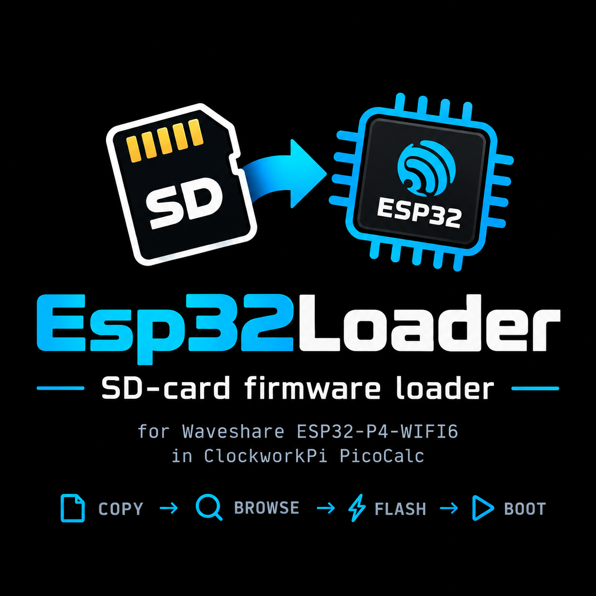
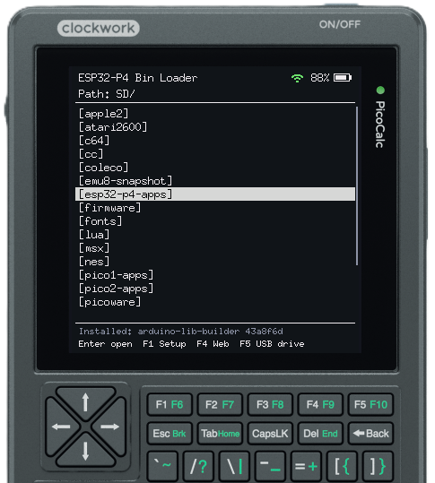
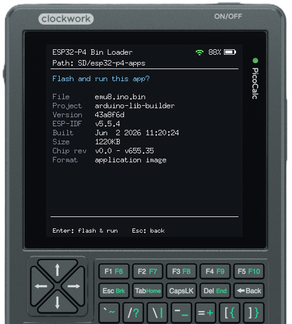
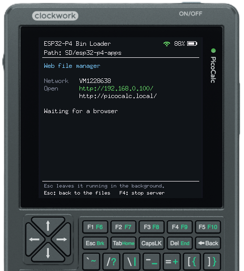
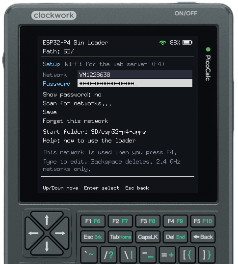
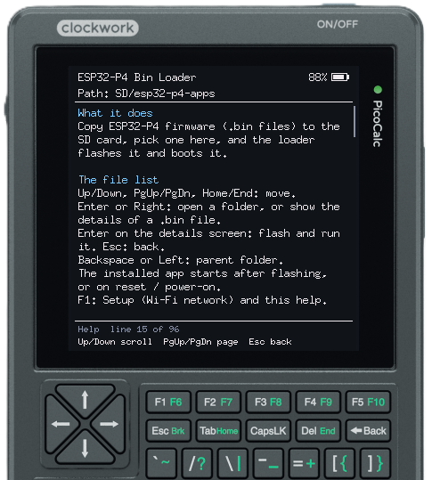
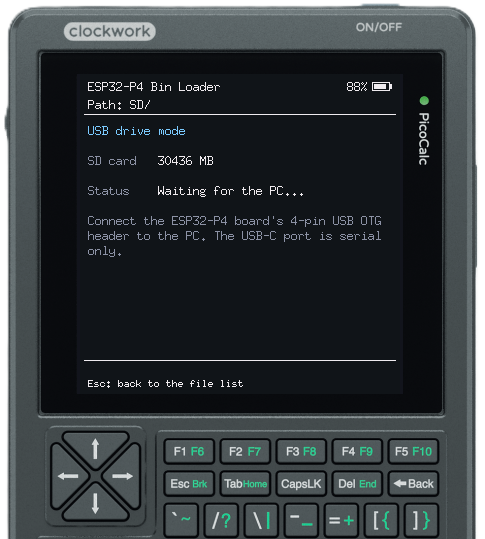
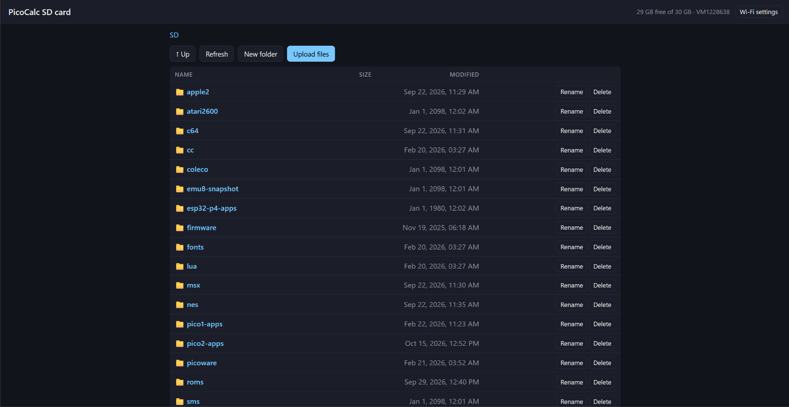
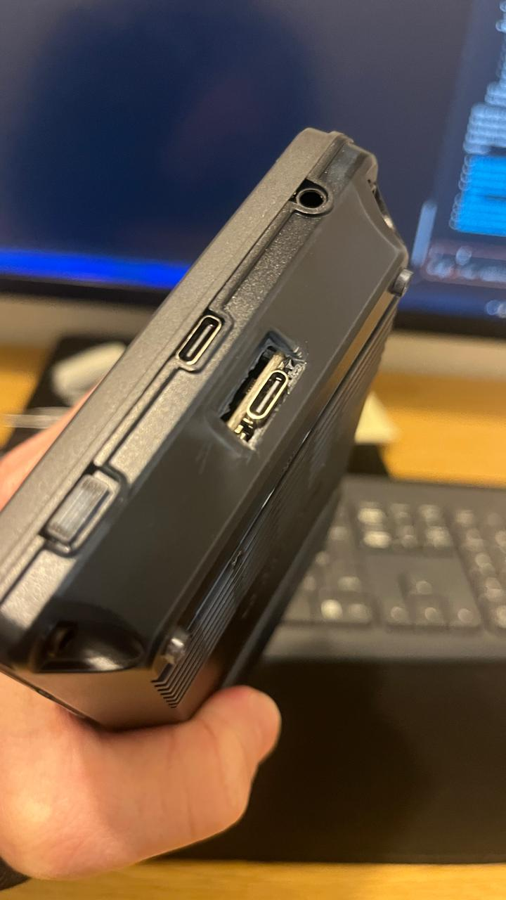

<p align="center"></p>

An SD-card firmware loader for a **Waveshare ESP32-P4-WIFI6 fitted in a ClockworkPi PicoCalc**,
in the spirit of [uf2loader](https://github.com/pelrun/uf2loader). Copy `.bin` files to the
PicoCalc's microSD card, browse to one on the LCD with the keyboard, and the loader flashes and
boots it. Hold **Up** (or F1/F5) while resetting to come back.

## Screenshots

|  |  |
|:---:|:---:|
| File list (the Wi-Fi icon shows the web server is on) | Checking an app before flashing it |
|  |  |
| Web file manager (F4) | Setup (F1): Wi-Fi network and start folder |
|  |  |
| On-screen help | USB drive mode (F5) |

<p align="center">
  <br>
  <em>The web file manager (F4) in a browser</em>
</p>

## How it works

```
0x002000  bootloader   custom 2nd-stage bootloader (bootloader_components/main)
0x008000  partition table
0x009000  nvs
0x00F000  otadata      which app slot to boot
0x020000  factory  2M  this loader
0x220000  ota_0   10M  the app you picked from the SD card
0xC20000  storage ~20M FAT data partition, free for apps to use      (32 MB flash)
```

* **Loader** (`main/`): draws a file browser on the PicoCalc LCD, lists folders and `*.bin`
  files on the SD card, and checks the selected image (ESP32-P4 chip ID, chip revision, app
  descriptor). It then writes the image to `ota_0` with the ESP-IDF OTA API, which verifies
  the checksum and SHA256, marks it bootable and reboots.
* **Bootloader** (`bootloader_components/main`): the stock ESP-IDF bootloader plus a check
  for 500 ms after reset. If a PicoCalc key (Up, F1 or F5) or the board's BOOT button is
  pressed in that window, or an app asked for the loader in software, it boots the `factory`
  loader instead of the app. The keyboard is read over bit-banged I2C.
* Loaded apps are **not modified**. The flash MMU maps whichever app partition is booted,
  so any ESP-IDF, Arduino or MicroPython build for the ESP32-P4 runs from `ota_0`.

### Supported files

* A plain app image, e.g. `build/<project>.bin` from ESP-IDF or the Arduino
  "Export compiled binary" output.
* A merged/full-flash image from `esptool merge_bin`, such as `*.factory.bin`. The loader
  reads the partition table inside the file and extracts only the app, so your bootloader
  is never overwritten.

## Hardware

### The board: Waveshare ESP32-P4-WIFI6

<p align="center">
  
</p>

The [ESP32-P4-WIFI6](https://www.waveshare.com/wiki/ESP32-P4-WIFI6) has the same footprint and
pin layout as a Raspberry Pi Pico, so it goes in the PicoCalc's Pico socket in place of a Pico /
Pico 2. It carries an ESP32-P4NRW32 (32 MB PSRAM in the package), 32 MB flash, an ESP32-C6
co-processor for Wi-Fi 6 / Bluetooth LE, MIPI display and camera connectors, a microSD slot and a
4-pin USB 2.0 high-speed header.

| Onboard parts | Pinout |
|:---:|:---:|
|  |  |

*Pictures: Waveshare. They are linked from the [Waveshare wiki](https://www.waveshare.com/wiki/ESP32-P4-WIFI6), not copied into this repo.*

### Fitting it in the PicoCalc (case modification)

The PicoCalc's case has a small opening for the Pico's micro-USB port. The ESP32-P4-WIFI6 has a
larger **USB-C** connector in that spot, so the board doesn't sit in the socket, and no cable fits,
until the opening is made bigger:

1. Open the PicoCalc and take out the Pico.
2. Enlarge the opening for the Pico's USB port (the right-hand one in the photo; the left one is
   the PicoCalc's own USB-C) to fit the board's USB-C connector and a cable plug. A craft knife,
   small files or a rotary tool work. Take a little off at a time and test-fit the board.
3. Clean up the plastic dust, fit the ESP32-P4-WIFI6 in the Pico socket with the USB-C port
   facing the opening, and close the case.

This USB-C port is the board's serial/flashing port (CH343). Use it to flash the loader and to
reach the serial console.

<p align="center">
  <br>
  <em>The enlarged opening (right) next to the PicoCalc's own USB-C port (left).</em>
</p>

### ESP32-P4 vs RP2040 vs RP2350

How the P4 board compares with the chips on the Picos that the PicoCalc normally takes:

| | **ESP32-P4** (Waveshare ESP32-P4-WIFI6) | **RP2040** (Pico / Pico W) | **RP2350** (Pico 2 / Pico 2 W) |
|---|---|---|---|
| CPU | 2× RISC-V @ 360 MHz (chip v1.x) / 400 MHz (v3.x), plus a RISC-V low-power core @ 40 MHz | 2× Arm Cortex-M0+ @ 133 MHz (200 MHz certified) | 2× Arm Cortex-M33 or 2× Hazard3 RISC-V @ 150 MHz |
| Floating point | Single-precision FPU, SIMD/AI instructions | None (software) | Single-precision FPU (M33), double-precision coprocessor |
| On-chip SRAM | 768 KB + 32 KB low-power + 8 KB TCM | 264 KB | 520 KB |
| PSRAM | 32 MB in the package | None | None on the Pico 2 (supported via QSPI) |
| Flash on the board | 32 MB | 2 MB | 4 MB |
| Wireless | Wi-Fi 6 (2.4 GHz) + Bluetooth 5 LE, through the ESP32-C6 | Pico W: Wi-Fi 4 (2.4 GHz) + Bluetooth 5.2 (CYW43439) | Pico 2 W: Wi-Fi 4 (2.4 GHz) + Bluetooth 5.2 (CYW43439) |
| USB | USB 2.0 **high-speed** OTG (480 Mbit/s) + full-speed; USB-C serial via CH343 | USB 1.1 full-speed (12 Mbit/s) device/host | USB 1.1 full-speed (12 Mbit/s) device/host |
| Programmable I/O | No PIO (has a parallel I/O peripheral) | 2 PIO blocks, 8 state machines | 3 PIO blocks, 12 state machines, HSTX |
| Display / camera / media | MIPI-DSI, MIPI-CSI, ISP, H.264 encoder, JPEG codec, 2D pixel accelerator | — | — (HSTX can drive DVI) |
| SD card | SD 3.0 host controller (SDIO slot on the board) | SPI or PIO | SPI or PIO |
| GPIO on the chip | 55 | 30 | 30 (QFN-60) / 48 (QFN-80) |
| Security | Secure boot, flash encryption, crypto accelerators | — | Secure boot, TrustZone, OTP, glitch detectors |
| PicoCalc firmware loader | **esp32loader** (`.bin` from SD) | [uf2loader](https://github.com/pelrun/uf2loader) (`.uf2` from SD) | [uf2loader](https://github.com/pelrun/uf2loader) (`.uf2` from SD) |

### Pins used by the loader

The pin map is in `main/board.h` (taken from emu8's `BOARD_PICOCALC_P4`):

| Part | Bus | Pins |
|---|---|---|
| LCD ST7365P 320x320 | SPI2, 40 MHz | SCK 3, MOSI 2, CS 7, DC 24, RST 25 |
| Keyboard / battery / backlight (STM32 @ 0x1F) | I2C 10 kHz | SDA 50, SCL 49 |
| microSD | SPI3, 20 MHz | SCK 46, MISO 48, MOSI 33, CS 47 (powered by on-chip LDO 4) |

GPIO24/25 are the USB-Serial-JTAG pads, so the console is UART only (GPIO37/38, the CH343
USB port). The keyboard and LCD are powered by the PicoCalc, not the P4. If the P4 runs from
USB with the PicoCalc switched off, the loader keeps polling, and it re-initialises the panel
once the keyboard answers.

## Build and flash the loader (once, over USB)

```powershell
. $HOME\esp\esp-idf\export.ps1
idf.py set-target esp32p4
idf.py build
idf.py -p COMx flash monitor
```

**Chip revision:** `sdkconfig.defaults` targets v3.x silicon. Run `esptool.py chip_id` to
check your chip. On a v1.x board, uncomment `CONFIG_ESP32P4_SELECTS_REV_LESS_V3=y`, delete
`sdkconfig`, and rebuild. The app images you load must be built for the same revision
family, and the loader rejects ones that aren't.

## Usage

1. Format a microSD card as FAT32 and copy `.bin` files to it, in any folder.
2. Switch the PicoCalc on. The loader starts when nothing is installed yet. Otherwise,
   **hold Up (or F1/F5) and press reset / power-cycle**.
3. Keys:

   | Key | Action |
   |---|---|
   | Up / Down, PgUp / PgDn, Home / End | move the selection |
   | Enter / Right | open a folder, or show the file's details |
   | Enter (on the details screen) | flash and run it |
   | Backspace / Left | parent folder / back |
   | F1 | Setup: Wi-Fi network, and the on-screen help (below) |
   | F4 | web file manager over Wi-Fi (below) |
   | F5 | USB drive mode (below) |

   Esc in the file list does nothing: the installed app only starts after flashing, or on
   reset / power-on. The serial console accepts the same keys (arrows, Enter, Backspace, Esc,
   F1/F4/F5 and typed text), so it works without the PicoCalc keyboard too. Ctrl+P prints the
   screen as text; `tools/screenshots/` turns that into the pictures above.
4. The loader remembers the last folder, and preselects the file you flashed last.

The board's BOOT button also works: press it within 0.5 s *after* releasing RESET. Holding
it *while* releasing RESET enters ROM download mode instead, because GPIO35 is a strapping pin.

### USB drive mode (F5)

Press **F5** in the file list to share the SD card with a PC. It needs the board's **4-pin USB
OTG 2.0 HS header** (VBUS, D-, D+, GND) wired to a USB cable going to the PC. The board's USB-C
port goes to the CH343 USB-to-serial chip and can't carry USB storage. The card then appears as
a USB drive. The screen shows *Waiting for the PC*, *Connected* or *Cable unplugged*.

* While the PC has the card, the loader doesn't touch it.
* **Eject the drive on the PC** when you're done. The loader takes the card back and refreshes
  the list by itself. Esc also leaves, but only press it after ejecting, or you may lose
  unsaved writes.
* It uses the P4's high-speed USB port (TinyUSB, `espressif/esp_tinyusb`). The MSC callbacks
  are in `main/usb_drive.c` and pass raw SD sectors through. esp_tinyusb's own storage layer is
  deliberately not used, because it formats the card if it fails to mount it.

### Setup (F1)

Press **F1** in the file list to choose the Wi-Fi network the web server joins:

* Type the **Network** name and **Password** (Backspace deletes; *Show password* toggles the
  mask), or pick **Scan for networks...** and choose one from the list.
* **Save** stores them in NVS on the board's flash. **Forget this network** removes them.
* Up/Down or Tab move between rows; Home/End jump to the first/last row.
* **Wi-Fi autostart** (ON/OFF, Enter toggles) starts the web file manager in the background at
  switch-on, as if you pressed F4 and then Esc. It is OFF by default.
* **Start folder** picks the folder the file list opens in at switch-on: browse to it (Enter
  opens a folder, Left goes up) and choose *Use this folder*. *Remember the last folder*
  (the default) reopens wherever you were last.
* Only 2.4 GHz networks work, because the ESP32-C6 has no 5 GHz radio. Passwords must be 8–64
  characters, or empty for an open network.

The web page has the same setting under *Wi-Fi settings*. While the web server is on, scanning
is disabled, and a changed network is used the next time the server starts.

The last row, **Help: how to use the loader**, opens a scrollable on-screen guide. It covers the
keys, getting back to the loader, which files work, Wi-Fi, the web file manager, USB drive mode
and the serial console. Up/Down scroll, PgUp/PgDn page, Esc goes back.

### Web file manager (F4)

Press **F4** in the file list to manage the SD card from a browser over Wi-Fi:

1. If a network is set up (F1), the loader joins it and shows `http://<ip>/`. On most networks
   `http://picocalc.local/` works too.
2. If no network is set up, or it can't join within 20 s, it starts its own access point
   instead. The access point is called `PicoCalc-Loader-XXXX`, its password is shown on screen,
   and you open `http://192.168.4.1/`. The password is random, made once, and kept, so a phone
   can remember the network. The screen says why joining failed (*not found* or *wrong
   password?*).
3. In the page you can:
   * browse folders, then **upload** files (button or drag and drop, several at once, with
     progress), **download**, **rename**, **delete** (folders recursively) and create folders;
   * **Flash** a `.bin`, which stops the server and flashes and boots it with the usual checks,
     with progress on the PicoCalc screen.
4. **Esc** goes back to the file list and leaves the server running in the background. A Wi-Fi
   icon in the top bar shows it is on: green when ready, blue while starting, amber while
   reconnecting, red if it failed. The file list refreshes by itself when the browser changes
   files. Press **F4** again to see the server screen, and **F4 there** to stop it. Flashing a
   file (from the PicoCalc or the browser) and USB drive mode stop it first.

How it works: the P4 has no radio, so Wi-Fi goes through the board's ESP32-C6 over SDIO
(`espressif/esp_wifi_remote` + `espressif/esp_hosted`). The pins are the ESP32-P4 Function EV
board defaults: CLK 18, CMD 19, D0–D3 14–17, C6 reset 54. The server is `esp_http_server`, and
the page is `main/web/index.html`, embedded in the firmware. There is **no login**, so anyone on
the same network can change the card while F4 is on. Only use it on networks you trust, and stop
it when you're done.

The C6 on these boards ships with old ESP-Hosted firmware (reported as 0.0.0). The 3.x host
works with it in compatibility mode, and logs `major version mismatch`, which is harmless.

### Returning to the loader from your own app

Copy `main/loader_api.h` into your project and call `binloader_reboot_to_menu()`. It writes
a magic value to `LP_SYSTEM_REG_LP_STORE15_REG`, which survives a software reset, and then
restarts. This is the equivalent of the PicoCalc UF2 Loader's watchdog-scratch command.

## Configuration (`idf.py menuconfig`)

* *Bin loader: bootloader*: trigger window, BOOT button GPIO and debounce, keyboard
  trigger on/off and its I2C pins.
* *Bin loader*: the folder the browser starts in the very first time, before a folder has
  been remembered or set in Setup.

## Limitations / notes

* Apps use the loader's partition table. Apps that expect `nvs`, `phy_init` or a FAT
  partition named `storage` will find them. Apps that need other data partitions
  (e.g. `spiffs`) won't, so edit `partitions.csv` to suit. The table must stay at 0x8000.
* App rollback is disabled on purpose. Loaded apps don't know they need to confirm
  themselves, so with rollback on they would be reverted.
* Secure boot and flash encryption are not supported.
* The custom bootloader must fit in 0x2000–0x8000. With the keyboard trigger it only fits
  with `CONFIG_BOOTLOADER_LOG_LEVEL_WARN` (about 0x9E0 bytes free).
