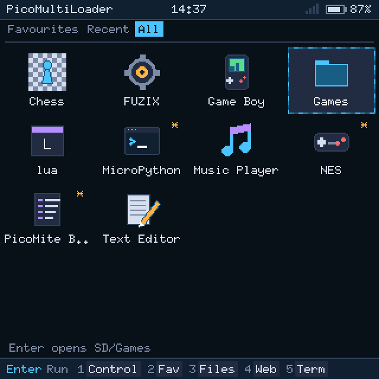
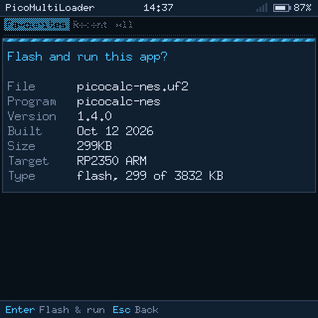

# Making your app PicoMultiLoader-ready

This guide is for people who make PicoCalc apps. It shows how to package an app so that
PicoMultiLoader's Home screen shows it with its own **icon**, **name**, **version**, **author**
and **description**, and how to make it work well with the loader.

You don't have to change your program. Any `.uf2` (Pico, Pico 2) or `.bin` (ESP32-P4) already runs
from the loader. The metadata is a small text file, `app.ini`, and an optional 32 × 32 icon. Both
go next to your binary in one folder.

|  |  |
|:---:|:---:|
| Home: icon and name from `app.ini`; version and description on the bottom line | Details before flashing, read from the binary itself |

## Quick start

1. Copy [examples/app-template/](../examples/app-template/) and rename the folder to your app's
   name, e.g. `MyApp/`.
2. Put your build output in it, e.g. `myapp.uf2`.
3. Edit `app.ini`: name, author, version, category, `binary`, `board`, desc.
4. Make an icon: draw a 32 × 32 picture and run `python tools/pml_app.py icon picture.png icon.bmp`
   (see [Icons](#icons)).
5. Check the folder: `python tools/pml_app.py check MyApp`. It reads the folder the same way the
   loader does and tells you what Home will show.
6. Ship the folder, e.g. as `MyApp.zip`. Users unzip it into the **root** of the SD card.

```
SD card root
├── MyApp/
│   ├── app.ini        metadata (optional, but recommended)
│   ├── icon.bmp       32x32 16-colour icon (optional)
│   ├── myapp.uf2      the program
│   └── ...            anything else your app needs: data, saves, ROMs...
└── pml/               the loader's own folder (favourites, recents, themes, screenshots)
```

## How Home finds apps

Home lists:

* every **folder in the root** of the card that has an `app.ini` or an app file (`.uf2` on the
  Picos, `.bin` on the ESP32-P4) in it, and
* every **app file in the root** itself. These show with their file name (without the extension)
  and a generic icon. There is no way to give them metadata, so use a folder.

Folders deeper down are not scanned. Hidden files and folders, names starting with `.`, and
`/pml` are skipped. Apps are sorted by name. A user can also add an app from anywhere on the card
to Favourites (F2 in Files), and it then shows on Home too.

Which file a folder runs:

| The folder has | Enter on Home |
|---|---|
| `binary` (or `binary.<board>`) in `app.ini`, and that file exists | Runs that file |
| No `binary` key, and exactly one app file | Runs it |
| No `binary` key, and several app files | Opens the folder on Home, one tile per app file (good for a collection, like `Games/`) |
| No app file at all, but an `app.ini` | Opens the folder |

"Runs" means: the loader shows the [details screen](#what-the-details-screen-shows), the user
presses Enter, and the loader flashes the app and starts it. If the app is already in flash, it
just starts.

## app.ini

### Syntax

```ini
; comments start with ";"
[app]
name     = NES
author   = picocalc community
version  = 1.4.0
category = Emulators            ; Emulators | Tools | Dev | Media
icon     = icon.bmp             ; the default
binary   = picocalc-nes.uf2     ; binary.rp2040 / binary.rp2350 / binary.esp32p4 win over it
board    = rp2040, rp2350       ; rp2040 | rp2350 | esp32p4 (or p4) | any
desc     = NES emulator with save states.
```

* One `key = value` per line. Keys are not case-sensitive. Spaces around `=` and at the ends of
  the value are trimmed.
* `;` starts a comment at the beginning of a line, or after a space or tab inside a value. A `;`
  with no space before it is part of the value (`desc = Save;load` keeps `Save;load`).
* Section headers (`[app]`) and lines without `=` are ignored. Write `[app]` anyway, so other
  tools can recognise the file.
* There are no quotes or escapes. A value is everything up to the end of the line or the comment.
* If a key appears twice, the first one wins. Unknown keys are ignored, so you may add your own.
* **Only the first 512 bytes are read.** Put the keys first and long comments at the end.
* Save the file as plain ASCII (or UTF-8 **without** a BOM). LF and CRLF line ends both work. The
  screen font is ASCII: letters such as `é` don't display.

### Keys

Every key is optional.

| Key | What it is | Max length | Where it shows | If it's missing |
|---|---|---|---|---|
| `name` | The app's name | 47 | Under the icon (first **12** characters), search, details, terminal `apps` | The folder name |
| `author` | Who made it | 31 | Details | Not shown |
| `version` | Version text, any format (`1.4.0`, `2026-10-27`, `beta 3`) | 15 | Home's bottom line, details | Not shown |
| `category` | `Emulators`, `Tools`, `Dev` or `Media` | 15 | Read and kept for grouping apps; this version doesn't show it yet | No category |
| `desc` | One line about the app | 95 | Home's bottom line, after the version | The folder path is shown |
| `icon` | File name of the icon, in the app's folder (no `/`) | 31 | Home tile | `icon.bmp`, then a generic icon |
| `binary` | File name of the program, in the app's folder (no `/`) | 63 | (what Enter runs) | The folder's only app file |
| `binary.rp2040`, `binary.rp2350`, `binary.esp32p4` | The program for that board; wins over `binary` | 63 | | `binary` |
| `board` | The boards the app is for: a list with any separator, e.g. `rp2040, rp2350` | 39 | | Shown on every board |

Longer values are cut at the maximum. Home's bottom line shows the version, two spaces, then
the description, **50 characters** in all, so keep `desc` to about 40 characters. The checker
warns about anything that will be cut.

### Boards and binaries

The loader on each board only uses files it can run. A `binary` that names a `.bin` is ignored on
the Picos, and one that names a `.uf2` is ignored on the ESP32-P4. If `board` is set and doesn't
name the board the loader runs on, the app is hidden there.

One folder can carry builds for several boards:

```ini
[app]
name           = Chess
version        = 2.1
category       = Tools
binary.rp2040  = chess-pico.uf2
binary.rp2350  = chess-pico2.uf2
binary.esp32p4 = chess-p4.bin
desc           = Play against the computer.
```

An RP2040 build is not an RP2350 build: the loader checks the UF2's family and refuses a file built
for the other chip. Give each Pico its own file with `binary.rp2040` / `binary.rp2350`, unless
you build one UF2 that holds both.

## Icons

The icon is a **32 × 32, 4-bit (16-colour), uncompressed BMP**, `icon.bmp` in the app folder
unless `icon` names another file. Top-down and bottom-up BMPs both work. Anything else (another
size, 8 or 24 bits, RLE compression, PNG) is ignored, and the generic icon is shown instead.

Each pixel's value is a **palette role**, not a colour. The colours stored in the BMP are ignored.
The loader paints each role in the user's theme colour, so your icon follows the theme:

<p align="center"></p>

| Index | Role | Use it for | Graphite (default theme) |
|---|---|---|---|
| 0 | *(clear)* | Background: the tile shows through | — |
| 1 | PANEL | Dark fill | `#172030` |
| 2 | FIELD | Raised surfaces, bodies | `#212c40` |
| 3 | LINE | Outlines, frames | `#33415c` |
| 4 | DIM | Shadows, secondary detail | `#7a88a3` |
| 5 | FG | Normal text colour, light parts | `#d5ddeb` |
| 6 | BRIGHT | Highlights | `#ffffff` |
| 7 | ACCENT | The theme's main colour | `#4cc3ff` |
| 8 | ACCDK | Dark accent | `#1d5f86` |
| 9 | OK | Green | `#5fd98a` |
| 10 | WARN | Yellow / amber | `#ffb347` |
| 11 | ERR | Red | `#ff6b6b` |
| 12 | ACC2 | Second accent | `#b48cff` |
| 13–15 | cycled | Animated: cycles through the accent colours a few times a second | — |

Tips:

* Leave a pixel or two of clear border. The icon sits on a tile that is highlighted when selected.
* Use LINE for outlines and FIELD/PANEL for bodies, and keep ACCENT, OK, WARN, ERR and ACC2 for small
  details. The icon then looks right in light themes (Paper) as well as dark ones.
* Fine detail is lost at this size. Draw a simple, bold shape.

### Making the icon

**From a picture** (PNG with transparency is best):

```sh
python tools/pml_app.py icon logo.png MyApp/icon.bmp
```

The picture is scaled to 32 × 32, transparent pixels become role 0, and every other pixel gets
the role whose Graphite colour is closest. The BMP's own palette is set to the Graphite colours,
so the file also looks right in an image viewer.

**Drawn by hand:** use an editor that saves 4-bit indexed BMPs (e.g. GIMP or Aseprite), and pick
palette entries by number, as in the table. If you
draw a 32 × 32 indexed PNG that way, keep its indices with:

```sh
python tools/pml_app.py icon drawing.png MyApp/icon.bmp --keep-indices
```

**Check it in every theme:**

```sh
python tools/pml_app.py preview MyApp icon-preview.png
```

## What the details screen shows

Before flashing, the loader reads the binary itself (not `app.ini`) and shows its program name,
version, build date, size and target chip. To fill these in:

* **Pico SDK (`.uf2`):** set them in `binary_info`. The program name and build date are added
  by default. Add the version in CMake:

  ```cmake
  pico_set_program_name(myapp "My App")
  pico_set_program_version(myapp "1.0.0")
  ```

  or in C with `bi_decl(bi_program_version_string("1.0.0"));`. The loader looks for the
  `binary_info` header near the start of the image, where the SDK puts it.
* **ESP-IDF / Arduino (`.bin`):** the app descriptor gives the project name, version
  (`PROJECT_VER`, or `git describe`), and the compile date and time.

Use the same version in `app.ini`, so Home and the details screen agree.

## Being a good citizen

These are optional, but users notice them.

* **Getting back to the menu.** Users can always hold **Up** (or F1/F5) and reset. A *Quit* or
  *Exit to menu* command in your app is nicer:
  * **Pico / Pico 2:** set watchdog scratch 0 = `0xe98cc638` and scratch 1 = `1`, then do a
    watchdog reboot. This is the same request [uf2loader](https://github.com/pelrun/uf2loader) uses,
    so apps written for it already work.

    ```c
    #include "hardware/watchdog.h"
    watchdog_hw->scratch[0] = 0xe98cc638;
    watchdog_hw->scratch[1] = 1;
    watchdog_reboot(0, 0, 0);
    ```
  * **ESP32-P4:** copy [esp32p4/main/loader_api.h](../esp32p4/main/loader_api.h) into your project
    and call `picomultiloader_reboot_to_menu()`.
* **Leaving a message.** Write a line to `/pml/exit.txt` on the card before you exit, e.g.
  `Saved game in slot 2`. The menu shows it once when it opens, then deletes the file. To leave a
  number instead, set watchdog scratch 2 = `0x504D4C58` ("PMLX") and scratch 3 = the code
  before the reboot (Picos), or call `picomultiloader_exit_code(code)` (ESP32-P4).
* **Keep your files in your folder.** Saves, settings and data next to your binary keep the card
  tidy, and users can copy or delete the app as one folder. Don't write to `/pml/`, which belongs
  to the loader.
* **Flash use on the Pico 2 W.** The last 256 KB of flash holds the loader's Wi-Fi files, so apps
  have 3832 KB there. An app that writes a file system into that area loses its data when the user
  turns Wi-Fi on in the loader, which asks the user first. On the RP2040, the last 256 KB of flash
  is the loader itself: don't write there.
* **RAM-only builds** (`no_flash` UF2s) are refused. Build a normal flash binary.

## Checklist

- [ ] One folder in the SD root, holding the binary
- [ ] `app.ini` under 512 bytes, with at least `name`, `version` and `desc`
- [ ] `name` reads well in 12 characters; version + desc fit in 50
- [ ] `category` is one of Emulators, Tools, Dev, Media
- [ ] `binary` names the file, or there is only one app file in the folder
- [ ] `board` lists only the boards you built for
- [ ] `icon.bmp`: 32 × 32, 4-bit, uncompressed, with role 0 as background
- [ ] Program version set in `binary_info` / the app descriptor
- [ ] `python tools/pml_app.py check <folder>` shows no errors

## Favourites and recents

These are the user's files, but good to know: Favourites (F2) and recently run apps are kept in
`/pml/favourites.txt` and `/pml/recents.txt`, one path per line (`/MyApp`, or a file such as
`/Games/tetris.uf2`). The loader keeps the last 8 recent apps. Users can edit both files by hand.
